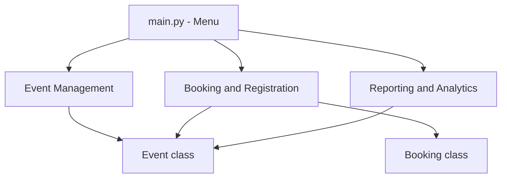
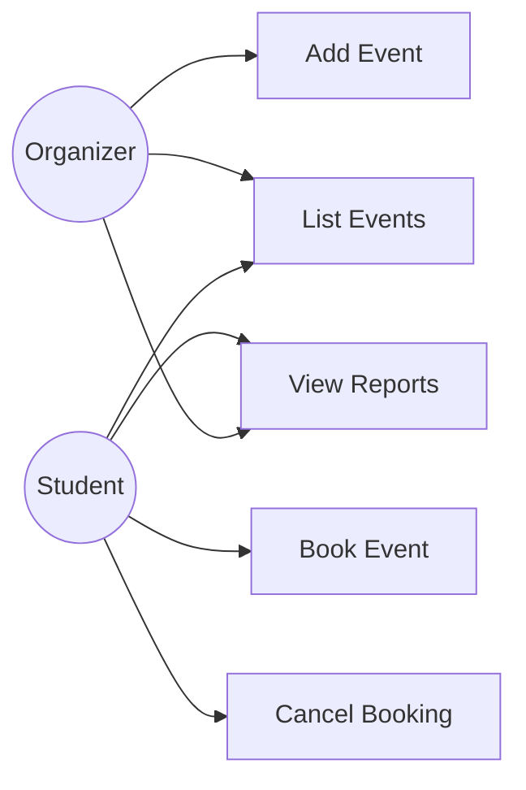
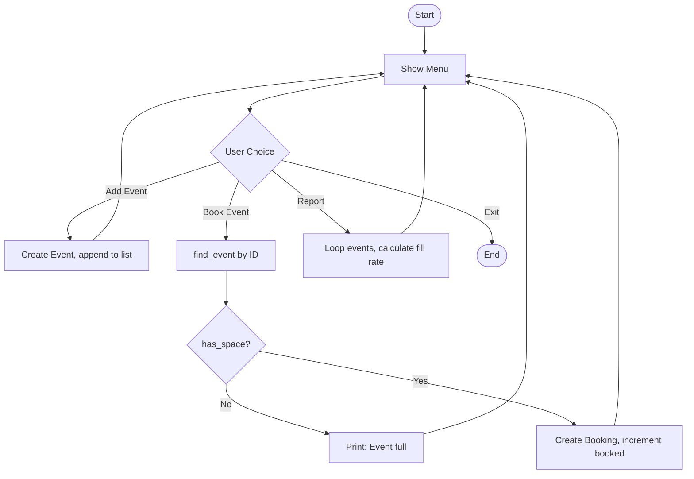
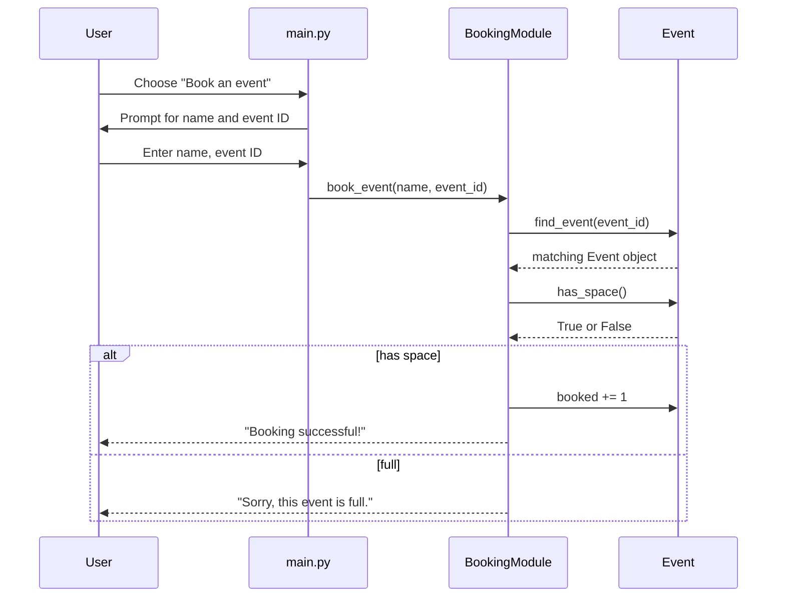
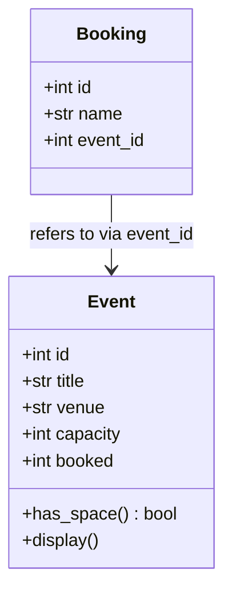

# Campus Event Tracker & Booking System
### Project Report

---

## 1. Cover Page

- **Project Title:** Campus Event Tracker & Booking System
- **Name:** [Your Name]
- **Registration Number:** [Your Reg. No.]
- **Course:** [Course Name / Code]
- **Submission Date:** [Date]

---

## 2. Introduction

Campus life involves a constant stream of events — workshops, cultural
fests, sports meets, guest lectures — but most colleges have no simple,
centralized way for students to see what's happening and reserve a seat
before it fills up. Organizers, on the other end, usually track sign-ups
through spreadsheets or messaging groups, which makes it easy to
accidentally accept more registrations than an event actually has room
for.

The Campus Event Tracker & Booking System is a command-line Python
application built to solve this in miniature. It lets an organizer add
an event with a fixed seat capacity, lets a student book a seat only
while space remains, and gives both a simple way to see how full events
are and which one is most popular. The project was built specifically
to apply the fundamentals covered in this course — variables, data
types, loops, decision-making, lists, dictionaries, functions, and
object-oriented programming — to a problem that feels like something a
real college might actually use, rather than a toy exercise.

---

## 3. Problem Statement

Without a booking system, two things tend to go wrong: students don't
have a reliable way to check whether an event has already filled up
before they show up, and organizers have no easy way to enforce a
capacity limit once registrations are being tracked manually. A
spreadsheet doesn't stop someone from adding a 51st name to an event
with 50 seats — someone has to notice and reject it by hand, which
doesn't scale and is easy to get wrong.

This project solves that by putting the capacity check directly into
the booking logic: an event object always knows how many seats it has
and how many are taken, and the booking function checks that before
ever creating a new booking. That single rule — enforced in code rather
than by a human double-checking a spreadsheet — is really the core
purpose of the project.

**Scope:** to keep the implementation focused on the course material
rather than infrastructure, the system is a single-session, in-memory
command-line tool. There's no database, no user accounts/login, and no
graphical interface — all data lives in two Python lists for the
duration of one run.

**Target users:** student event organizers (clubs, fest committees) who
need to list an event and track how full it is, and students who want
to check what's on and reserve a seat.

---

## 4. Functional Requirements

The system is organized into three functional modules, each handling
one part of the workflow:

**Module 1 — Event Management**
- Add a new event by supplying a title, venue, and capacity
- List every event currently stored, along with how many seats are
  booked out of the total capacity
- Look up a single event by its numeric ID (used internally by the
  other two modules)

**Module 2 — Booking & Registration**
- Book a seat at an event by providing a name and an event ID; the
  booking is only accepted if the event still has space
- Cancel an existing booking by its booking ID, which frees up the
  corresponding seat on the event

**Module 3 — Reporting & Analytics**
- Generate a fill-rate report showing what percentage of each event's
  capacity has been booked
- Identify the single most popular event, based on which one has the
  highest number of bookings

**Input/Output structure:** every input is collected through the
terminal using Python's `input()` function — event details, student
names, and numeric IDs are all typed in response to prompts. All
output — confirmations, error messages, and reports — is printed
straight back to the terminal with `print()`.

**User workflow:** the program shows a numbered menu inside an infinite
loop. The user types the number of the action they want, is asked any
follow-up questions that action needs (like an event title or a
capacity number), sees the result immediately, and is returned to the
same menu. The loop only ends when the user explicitly chooses the
exit option.

---

## 5. Non-Functional Requirements

| Requirement | How it's addressed |
|---|---|
| **Usability** | The interface is a plain numbered menu — a user doesn't need any programming knowledge, just the ability to read a prompt and type a number or a name |
| **Reliability** | `has_space()` is checked on the `Event` object before every single booking is created, so it's structurally impossible for `booked` to exceed `capacity` |
| **Maintainability** | The three modules (event management, booking, reporting) are kept as separate groups of functions, so a change to how bookings work, for example, doesn't require touching the reporting logic at all |
| **Error handling** | Every lookup that could fail — an invalid event ID, an invalid booking ID, an unrecognized menu choice — is checked with an `if`/`elif` before acting, and prints a clear message instead of crashing |
| **Performance** | All operations run over small in-memory Python lists with simple loops, which is more than fast enough at the scale a single class, club, or fest would need |

---

## 6. System Architecture

The architecture is intentionally simple and layered: `main.py` is the
only part of the program that ever talks directly to the user. It reads
input from the menu and calls into whichever module handles that
action. Those modules, in turn, operate on the two model classes,
`Event` and `Booking`, which hold the actual data.

This separation means the menu never needs to know *how* a booking is
validated — it just calls `book_event()` and prints whatever comes
back. If the booking rules changed later (say, to support a waitlist),
only the booking module would need to change.

---

## 7. Design Diagrams

### 7.1 Use Case Diagram

There are two actors: the **Organizer**, who manages events, and the
**Student**, who books them. Both can view reports.

### 7.2 Workflow Diagram

This traces what happens for each menu choice, in particular the
capacity check that sits at the center of the booking flow.

### 7.3 Sequence Diagram

This shows the exact order of calls between the menu, the booking
module, and the `Event` object when a student books a seat — including
both the success and full-capacity outcomes.

### 7.4 Class / Component Diagram

The `Event` class bundles all of an event's data together with the one
piece of logic that matters most — `has_space()` — so that rule lives
in exactly one place rather than being re-checked differently in
several functions. `Booking` is deliberately minimal: it just records
who booked and which event they're linked to, referencing the event by
its `id` rather than holding a full copy of the event's data.

### 7.5 ER Diagram

Not applicable. This project intentionally stores data in plain Python
lists (`events` and `bookings`) rather than a database, so there is no
persistent schema to diagram. This was a deliberate scope decision
(explained further in Section 8) rather than an omission.

---

## 8. Design Decisions & Rationale

**Why plain Python lists instead of a database?**
The course covers lists, tuples, and dictionaries as core data
structures, but not SQL or database design, so using a database would
have pulled in a tool outside what the project is meant to demonstrate.
Keeping `events` and `bookings` as plain lists of objects means the
entire project stays inside the concepts actually being assessed —
storing, looping over, and searching through collections — while still
behaving like a real system from the user's point of view.

**Why reject a booking outright instead of using a waitlist?**
An earlier version of this project did include a waitlist, using a
queue-like structure to hold students until a seat opened up. That
added real value, but it also relied on structures and edge-case logic
(promoting the next person in line automatically when someone cancels)
that go beyond this course's scope. The final version simplifies this
down to a straightforward capacity check: if `has_space()` returns
`False`, the booking is rejected with a clear message. This keeps the
core lesson — "don't let bookings exceed capacity" — intact without
adding logic the course hasn't covered.

**Why two separate classes (`Event` and `Booking`) instead of one?**
An event and a booking represent two different real-world things with
different lifecycles — an event exists independently and can have many
bookings, while a booking only makes sense in relation to one event.
Splitting them into two classes mirrors that relationship directly:
`Booking` stores an `event_id` that links back to its `Event`, rather
than every booking needing to duplicate the event's title, venue, and
capacity.

**Why a plain `if/elif` menu instead of a dictionary-based dispatch
table?**
An earlier draft of the menu used a dictionary that mapped each menu
number directly to a function, with `lambda` used to wrap functions
that needed extra arguments collected from `input()` first. That version
worked, but it depended on `lambda`, which isn't something this course
covers, and it made the control flow harder to follow at a glance. The
final version uses a straightforward `if/elif/else` chain instead —
more lines of code, but each branch is a plain, readable block that
maps directly to the decision-making concepts taught in the course.

---

## 9. Implementation Details

**`Event` class** — Holds an event's `id`, `title`, `venue`,
`capacity`, and a running `booked` count that starts at 0. Its
`has_space()` method compares `booked` to `capacity` and returns a
boolean, and `display()` prints a formatted one-line summary of the
event. Keeping this logic as a method on the class, rather than a
separate function that takes an event as an argument, means every part
of the program checks capacity the same way.

**`Booking` class** — A small class storing just an `id`, the
student's `name`, and the `event_id` it refers to. It has no methods of
its own; it's purely a data container.

**`add_event()`, `list_events()`, `find_event()` (Module 1)** —
`add_event()` generates a new ID by taking `len(events) + 1`, creates
an `Event` object, and appends it to the `events` list. `list_events()`
loops through the list and calls `display()` on each event, or prints a
message if the list is empty. `find_event()` loops through `events`
looking for a matching `id` and returns that object, or `None` if
nothing matches — this `None` result is what `book_event()` and
`cancel_booking()` check for to report "Event not found."

**`book_event()`, `cancel_booking()` (Module 2)** — `book_event()`
first calls `find_event()`, then checks the result: if it's `None`, the
event doesn't exist; if `has_space()` is `False`, the event is full;
otherwise, a new `Booking` is created, appended to the `bookings` list,
and the event's `booked` count is incremented. `cancel_booking()` finds
the matching booking, removes it from the list, and decrements the
related event's `booked` count so the seat becomes available again.

**`fill_rate_report()`, `most_popular_event()` (Module 3)** —
`fill_rate_report()` loops through every event and calculates
`(booked / capacity) * 100`, printing the result rounded to one decimal
place. `most_popular_event()` starts by assuming the first event in the
list is the most popular, then loops through the rest, replacing that
assumption any time it finds an event with a higher `booked` count —
a simple "running maximum" pattern using only a loop and an `if`.

**`main()`** — Runs an infinite `while True` loop that prints the menu
and reads the user's choice with `input()`. An `if/elif/else` chain
checks that choice against each menu number, collecting any additional
input needed (like a title or an event ID) before calling the relevant
function. Choosing `0` breaks out of the loop and ends the program.

---

## 10. Screenshots / Results

*(Run `python main.py` yourself and paste screenshots here showing:)*
1. The main menu
2. Adding an event
3. Booking a seat successfully, then booking again until the event is
   full and seeing the rejection message
4. The fill-rate report and most-popular-event output

---

## 11. Testing Approach

Testing was carried out manually by running the program and exercising
each code path directly:

- Added an event with a small capacity (2) and booked it exactly to
  capacity with two different names — both bookings succeeded and
  `list_events()` correctly showed `2/2 booked`.
- Attempted a third booking on the same, now-full event — the program
  correctly printed "Sorry, this event is full." and did not create a
  new `Booking` object (confirmed by checking `list_events()` still
  showed only 2 bookings).
- Cancelled one of the two bookings and confirmed the event's `booked`
  count dropped back to 1, then successfully booked a new name into the
  freed-up seat.
- Entered an out-of-range menu option (e.g. `9`) and confirmed the
  program printed "Invalid choice, please try again." rather than
  crashing.
- Attempted to book a non-existent event ID and confirmed the program
  printed "Event not found." instead of raising an error.

---

## 12. Challenges Faced

The biggest early confusion was around `__init__` — specifically, why
it doesn't need to be called manually the way other functions do.
Understanding that Python calls it automatically the moment an object
is created, and that `self` refers to "this particular object being
built," was the turning point for feeling comfortable writing the
`Event` and `Booking` classes.

A second point of confusion was `lambda`, which showed up in an
earlier version of the menu that mapped numbers to functions inside a
dictionary. It took a while to understand that `lambda` just wraps up
code that takes user input into a function you can call *later*,
rather than running it immediately when the dictionary is built.

The main challenge, though, was giving up on some of the extra features
originally planned for this project. The first working version was
considerably more advanced — it included things like a waitlist system
for full events, JSON file persistence so data would survive between
runs, and separate organizer/student permission classes. Once that
logic started involving concepts outside what this course has actually
covered, it became difficult to fully understand and maintain, so the
decision was made to scale back to a simpler version: plain lists, two
basic classes, and a straightforward `if/elif` menu. It was a bit
disappointing to let go of the more feature-rich version, but settling
for something simpler that could actually be explained and understood
end-to-end felt like the more honest outcome than keeping code that
wasn't fully understood.

---

## 13. Learnings & Key Takeaways

Building this project made a few concepts click in a way that just
reading about them hadn't. Classes stopped feeling abstract once
`Event` was actually being used to bundle related data (`title`,
`venue`, `capacity`, `booked`) together with the one behavior that
mattered most for it, `has_space()` — it became clear that OOP is
really just a way to keep data and the logic that acts on it in the
same place, instead of scattered across separate variables and
functions.

Splitting the program into three modules also showed the practical
value of functions and modular design: being able to work on the
booking logic without needing to touch the reporting code, and being
able to test each part (adding an event, booking it, reading the
report) independently, made the whole program far easier to reason
about than one long block of code would have been.

Finally, this project reinforced that simpler, fully-understood code is
worth more than complex code copied or half-understood. Rolling back
the waitlist and persistence features wasn't just about staying inside
the syllabus — it was a genuine lesson in recognizing the difference
between code that *works* and code you can actually explain and defend.

---

## 14. Future Enhancements

- **Persistent storage:** save events and bookings to a file (e.g.
  JSON) so data survives between runs, instead of resetting every time
  the program starts.
- **Waitlist support:** instead of rejecting a booking outright once an
  event is full, add students to a waitlist and automatically promote
  the next person when someone cancels.
- **Input validation:** guard against invalid input such as a negative
  capacity, an empty title, or non-numeric IDs, with clearer error
  messages.
- **Role-based access:** reintroduce separate Organizer and Student
  roles so only organizers can add or remove events.
- **Web interface:** build a simple web front-end (e.g. with Flask) on
  top of the same underlying functions, so the tool doesn't require
  running from a terminal.

---

## 15. References

- Python official documentation: https://docs.python.org/3/
- [Add any course materials, lecture notes, or tutorials you personally referred to while building this]
